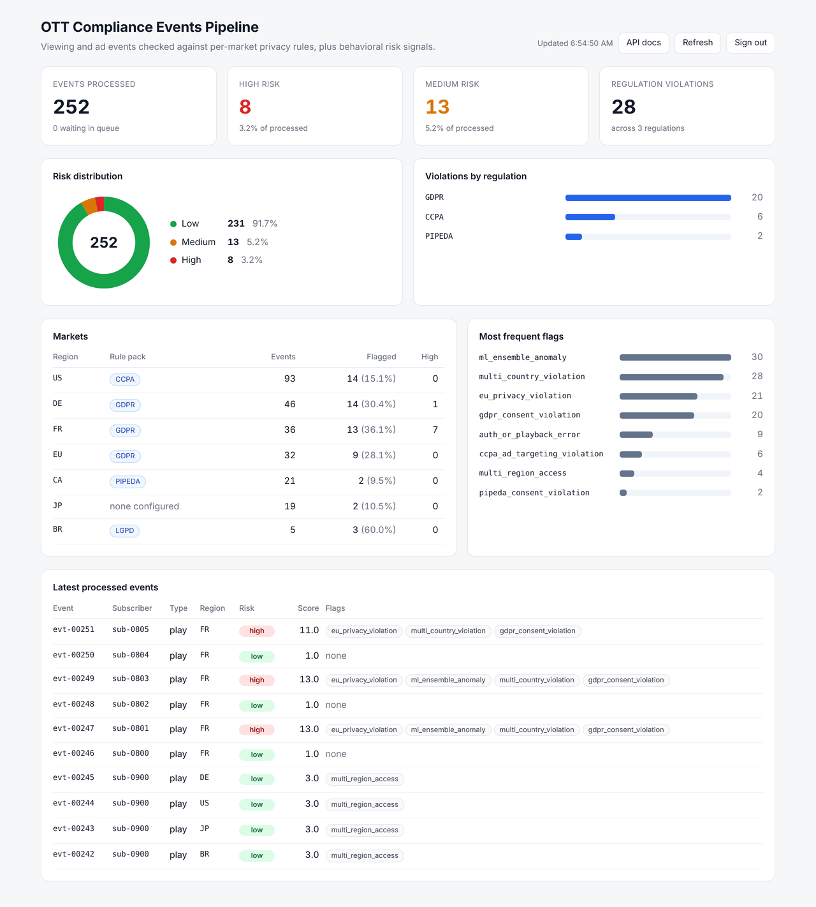
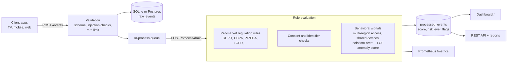
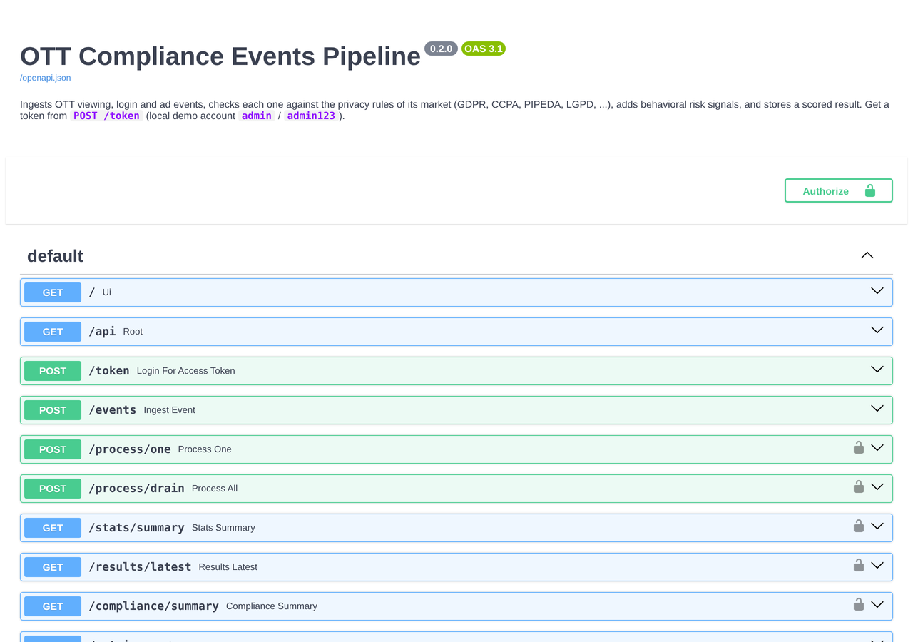

# OTT Compliance Events Pipeline

A FastAPI service that checks streaming-platform events (playback, login, ad impressions) against the privacy rules of the market they come from, and flags risky behavior early.



## The problem

An OTT service that ships in many countries cannot apply one privacy rule set everywhere. The same `play` or `ad_impression` event means different things depending on where the viewer is:

- In the EU (GDPR), processing viewing data for analytics or personalization needs a lawful basis, typically consent, and targeted ads need consent.
- In California (CCPA/CPRA), ordinary processing is opt-out, but a Global Privacy Control signal must be honored, so serving a cross-context targeted ad to a viewer who sent GPC is a problem.
- Canada (PIPEDA), Brazil (LGPD) and others have their own rules, and some markets may not have a rule pack configured at all.

On top of rule checks, compliance and trust teams want to see risky patterns (one account streaming from four countries within the hour, many accounts on one device, bursts of failed logins) before they turn into incidents.

This project is a working model of that pipeline: ingest events, evaluate each one against its market's rules plus behavioral signals, store a scored result, and show the picture on a dashboard and through an API.

## How it works



Each processed event gets a numeric score, a `low` / `medium` / `high` risk level, and a list of flags that explain the score, for example `gdpr_consent_violation`, `ccpa_ad_targeting_violation`, `multi_region_access`, `ml_ensemble_anomaly`.

Rules that are implemented today (see `src/app/regulations.py` and `src/app/compliance_rules.py`):

| Market | Regulation | Checks on ingested events |
| --- | --- | --- |
| EU and member states (`EU`, `DE`, `FR`, ...) | GDPR | Playback and login without consent; targeted ad without consent |
| `US` | CCPA | Targeted ad served despite a Global Privacy Control opt-out signal |
| `CA` | PIPEDA | Playback and login without consent |
| `BR`, `CN`, `TH`, `ZA`, `AU`, `TR`, `SG` | LGPD, PIPL, PDPA, POPIA, Privacy Act, KVKK, PDPA (SG) | Consent rules from each regulation's requirement table |
| Anything else (e.g. `JP`) | none configured | Shown as "none configured" so the gap is visible |

Behavioral signals: missing user or device IDs, auth and playback errors, more than two regions for one account within an hour, high-frequency activity, device and IP sharing across accounts (graph analysis with networkx), and an unsupervised anomaly score from scikit-learn IsolationForest and LocalOutlierFactor. The anomaly model waits for 50 events before it fits and refits every 50 events after that, so it starts flagging only once it has seen real traffic. It is a triage signal, not a measured classifier.

The risk thresholds adapt by hour of day, user segment and region history (`adaptive_thresholds.py`). This simplification of real legal analysis is intentional; the rules are a model for engineering discussion, not legal advice.

## Quickstart (no Kafka, Redis or Postgres needed)

Requires Python 3.11 or newer.

```bash
git clone https://github.com/deokhwajeong/ott-compliance-events-pipeline.git
cd ott-compliance-events-pipeline
python -m venv .venv && source .venv/bin/activate
pip install -r requirements-dev.txt

# Start the API (creates ./ott_compliance.db on first run)
uvicorn src.app.main:app --port 8000
```

In a second terminal, load synthetic demo data and process it:

```bash
python src/scripts/seed_demo.py --base-url http://127.0.0.1:8000
```

Then open:

- Dashboard: http://127.0.0.1:8000/ (local demo account `admin` / `admin123`)
- Interactive API docs: http://127.0.0.1:8000/docs
- Prometheus metrics: http://127.0.0.1:8000/metrics

Sending one event by hand:

```bash
curl -X POST http://127.0.0.1:8000/events -H 'Content-Type: application/json' -d '{
  "event_id": "evt-demo-1", "user_id": "sub-0001", "device_id": "tv-0001",
  "content_id": "title-001", "event_type": "ad_impression",
  "timestamp": "2026-01-01T20:00:00Z", "region": "US", "is_eu": false,
  "has_consent": true, "ip_address": "192.0.2.10",
  "extra_metadata": {"gpc": true, "targeted": true}
}'

TOKEN=$(curl -s -X POST http://127.0.0.1:8000/token -d 'username=admin&password=admin123' | python -c 'import sys,json;print(json.load(sys.stdin)["access_token"])')
curl -s -X POST http://127.0.0.1:8000/process/drain -H "Authorization: Bearer $TOKEN"
```

The result for that event includes `ccpa_ad_targeting_violation`.

### Configuration

| Variable | Default | Purpose |
| --- | --- | --- |
| `DATABASE_URL` | `sqlite:///./ott_compliance.db` | SQLAlchemy URL (set `DB_TYPE=postgresql` for a pooled Postgres engine) |
| `MODEL_DIR` | `models` | Where model state is saved on shutdown |
| `REDIS_HOST` / `REDIS_PORT` | `localhost` / `6379` | Optional cache; caching is skipped when Redis is unreachable |
| `GEOIP_DB_PATH` | `GeoLite2-City.mmdb` | Optional local MaxMind database for IP-to-region checks |
| `GEOIP_ALLOW_REMOTE_LOOKUP` | `0` | Opt in to a third-party IP lookup API (off by default, since sending subscriber IPs to a third party is itself a data transfer) |
| `SLACK_WEBHOOK_URL` | unset | Optional Slack channel for high-risk alerts (alerts are always logged) |

## What is verified

Verified in this repository on Python 3.12 from a clean checkout, without Kafka, Redis or Postgres:

- The API starts, and the dashboard, `/docs` and `/metrics` respond.
- `seed_demo.py` ingests 252 synthetic events and processes all of them; the dashboard shows the result (screenshot above).
- `pytest`: 36 tests pass, covering the regulation rules, the rule pipeline, the anomaly detector's warm-up behavior, input validation and rate limiting, and the API end to end (auth, ingest, drain, summaries, reports, dashboard data).
- Line coverage of `src/` is 62% (`pytest --cov`). The lower-covered modules are the optional integrations (Redis cache, Kafka manager, scheduler, alert channels).
- `ruff check` and `ruff format --check` are clean. GitHub Actions runs lint and tests on Python 3.11 and 3.12.
- Alembic migrations (`alembic upgrade head`) create the schema.

Not verified in this pass: the Docker image and `docker-compose.yml` (API, Redis, Prometheus, Grafana), the Kafka producer/consumer module (`kafka_manager.py`, which ingestion does not use by default), and the Slack, email, SMS and webhook alert channels.



## Project layout

```
src/app/
  main.py               FastAPI app: ingest, processing, summaries, dashboard data, reports
  compliance_rules.py   Per-event evaluation: combines all checks into score, level, flags
  regulations.py        Region-to-regulation mapping and rule checks
  schemas.py            Event schema and validation
  security.py           Injection pattern checks, sanitization, rate limiting
  ml_models.py          IsolationForest + LOF anomaly detector, violation likelihood
  adaptive_thresholds.py, user_segments.py, network_analysis.py, geoip_validator.py
  queue.py              In-process queue (Kafka-backed queue class available, off by default)
  auth.py               JWT auth with demo accounts
  audit_log.py, report_generator.py, advanced_analytics.py, metrics.py, alerting.py
  templates/dashboard.html   Dependency-free dashboard (no CDN needed)
src/scripts/seed_demo.py     Synthetic data generator (documentation-range IPs, generated IDs)
tests/                       pytest suite
alembic/                     Database migrations
grafana/, prometheus.yml     Monitoring configuration for docker-compose
```

## Roadmap

- Replace the demo user store and hard-coded JWT secret with real identity and secret management.
- Move processing off the request path (background worker, or turn on the existing Kafka queue) instead of `POST /process/drain`.
- Add rule packs for markets that show "none configured" (for example Japan's APPI, UK GDPR), and keep rules as data rather than code so policy owners can review changes.
- Add data-subject request flows (access and deletion deadlines are already modeled in `regulations.py` but not wired to events).
- Label a sample of flagged events to measure precision of the anomaly signal before giving it more weight.
- Verify and document the Docker and Grafana setup end to end.

## Data and privacy

All data in this repository is synthetic. The seed script generates subscriber, device and title IDs and uses IP addresses from the RFC 5737 documentation ranges, which are never assigned to real users. No database or generated reports are committed.

## Author

Deokhwa Jeong ([LinkedIn](https://www.linkedin.com/in/deokhwa-jeong))

Licensed under the MIT License.
