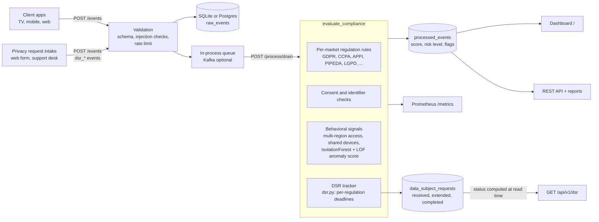
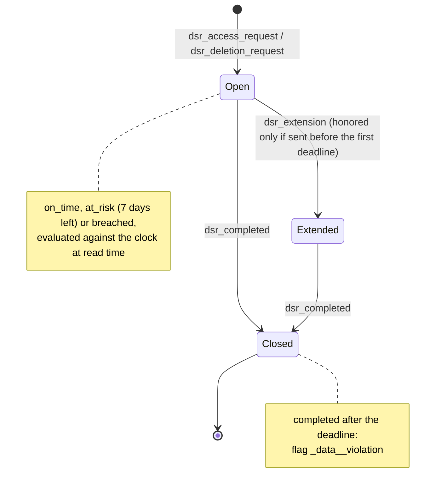

# OTT Compliance Events Pipeline

A FastAPI service that checks streaming-platform events (playback, login, ad impressions) against the privacy rules of the market they come from, and flags risky behavior early.


## Live demo

**[deokhwajeong.github.io/demos/ott-compliance/](https://deokhwajeong.github.io/demos/ott-compliance/)**: a static, no-backend dashboard for this pipeline. It shows event volume by market, consent coverage, rule violations by jurisdiction, data subject requests against each regulation's response deadline, and an event drill-down table with filters. A "Simulate an event" panel runs a browser port of the regulation rules so you can watch a GDPR, CCPA or APPI violation get flagged, and the page checks that port against the Python results (it agrees on every recorded event).

The numbers are not made up in JavaScript. `demo/export_fixture.py` runs the real app in process: it generates synthetic events with the `seed_demo.py` generator (360 random viewing events, 13 deliberate risky patterns and 64 data subject requests, which arrive as 112 `dsr_*` events), posts them to `POST /events`, processes them with `POST /process/drain` (against a throwaway SQLite file in a temp directory), reads each request's deadline status from `GET /api/v1/dsr`, and writes `demo/site/data/fixture.json`. The page only reads that file.

```bash
pip install -r requirements-dev.txt
demo/build.sh                      # re-export the fixture and assemble the site in demo/dist
SKIP_EXPORT=1 demo/build.sh out/   # reuse the committed fixture, write to out/
python -m http.server -d demo/dist 8080   # then open http://127.0.0.1:8080/
```

Source: `demo/site/` (plain HTML, CSS and JavaScript with hand-written SVG charts; no build step and no CDN).

## The problem

An OTT service that ships in many countries cannot apply one privacy rule set everywhere. The same `play` or `ad_impression` event means different things depending on where the viewer is:

- In the EU (GDPR), processing viewing data for analytics or personalization needs a lawful basis, typically consent, and targeted ads need consent.
- In California (CCPA/CPRA), ordinary processing is opt-out, but a Global Privacy Control signal must be honored, so serving a cross-context targeted ad to a viewer who sent GPC is a problem.
- In Japan (APPI), use within a published purpose of use needs no consent, but passing viewer data to a third-party ad partner does.
- Canada (PIPEDA), Brazil (LGPD) and others have their own rules, and some markets may not have a rule pack configured at all.
- Subscribers can ask to see or delete their data, and each law sets its own clock: one calendar month under GDPR, 45 days under CCPA, 15 days for an LGPD access request. A request that sits in a queue past that date is a violation even though no new event arrived.

On top of rule checks, compliance and trust teams want to see risky patterns (one account streaming from four countries within the hour, many accounts on one device, bursts of failed logins) before they turn into incidents.

This project is a working model of that pipeline: ingest events, evaluate each one against its market's rules plus behavioral signals, track data subject requests against their deadlines, store a scored result, and show the picture on a dashboard and through an API.

## How it works



A data subject request is a small state machine. Every step is an ordinary event with the same `extra_metadata.request_id`:



Each processed event gets a numeric score, a `low` / `medium` / `high` risk level, and a list of flags that explain the score, for example `gdpr_consent_violation`, `ccpa_ad_targeting_violation`, `multi_region_access`, `ml_ensemble_anomaly`.

Rules that are implemented today (see `src/app/regulations.py` and `src/app/compliance_rules.py`):

| Market | Regulation | Checks on ingested events |
| --- | --- | --- |
| EU and member states (`EU`, `DE`, `FR`, ...) | GDPR | Playback and login without consent; targeted ad without consent |
| `US` | CCPA | Targeted ad served despite a Global Privacy Control opt-out signal |
| `CA` | PIPEDA | Playback and login without consent |
| `JP` | APPI | Targeted ad whose viewer data goes to a third-party ad partner without consent (Art. 27(1), Art. 31); playback needs no consent (purpose of use, Arts. 17, 18, 21) |
| `BR`, `CN`, `TH`, `ZA`, `AU`, `TR`, `SG` | LGPD, PIPL, PDPA, POPIA, Privacy Act, KVKK, PDPA (SG) | Consent rules from each regulation's requirement table |
| Anything else (e.g. `KR`, `GB`) | none configured | Shown as "none configured" so the gap is visible |
| All markets above | DSR deadlines | Access and deletion requests completed after the regulation's deadline; open requests past it (see below) |

Behavioral signals: missing user or device IDs, auth and playback errors, more than two regions for one account within an hour, high-frequency activity, device and IP sharing across accounts (graph analysis with networkx), and an unsupervised anomaly score from scikit-learn IsolationForest and LocalOutlierFactor. The anomaly model waits for 50 events before it fits and refits every 50 events after that, so it starts flagging only once it has seen real traffic. It is a triage signal, not a measured classifier.

The risk thresholds adapt by hour of day, user segment and region history (`adaptive_thresholds.py`). This simplification of real legal analysis is intentional; the rules are a model for engineering discussion, not legal advice.

## Data subject requests

Access and deletion requests are ingested like any other event, using four event types: `dsr_access_request`, `dsr_deletion_request`, `dsr_extension` and `dsr_completed`. Each needs `extra_metadata.request_id` (the API rejects it with 422 otherwise). The pipeline keeps one row per request in `data_subject_requests`, works out the deadline from the regulation of the subscriber's market, and:

- flags a completion that lands after the deadline (`gdpr_data_deletion_violation`, `ccpa_data_access_violation`, ..., plus `dsr_deadline_missed`) and scores it like any other statutory finding;
- honors an extension only if the regulation allows one and the notice went out before the original deadline (otherwise `dsr_late_extension`);
- reports every request as `on_time`, `at_risk` (open with fewer than 7 days left) or `breached` from `GET /api/v1/dsr` (optional `as_of`), and lists the rules with their sources at `GET /api/v1/dsr/deadlines`.

Deadlines modeled in `src/app/dsr.py`:

| Regulation | Request | Deadline | Extension | Source |
| --- | --- | --- | --- | --- |
| GDPR | access, erasure | 1 calendar month from receipt | 2 further months, if the data subject is told within the first month | Art. 12(3) (requests under Arts. 15, 17) |
| CCPA / CPRA | right to know, right to delete | 45 calendar days | once, by 45 more days, with notice within the first 45 | Cal. Civ. Code 1798.130(a)(2)(A); 11 CCR 7021 |
| LGPD | access (complete declaration) | 15 days | none in the statute | Art. 19, II |
| LGPD | deletion | policy SLA, 15 days | none | Art. 18, VI; Art. 18 para. 5 leaves the period to ANPD regulation |
| PIPEDA | access | 30 days | up to 30 more days, with notice within the first 30 | s. 8(3) and 8(4); Schedule 1 Principle 4.9 |
| PIPEDA | deletion | policy SLA, 30 days | none | no general statutory erasure right (Principles 4.5.3, 4.9.5) |
| APPI | disclosure, cessation of use or erasure | policy SLA, 30 days | none | Art. 33(2), Art. 35: "without delay", no day count |
| Others (PIPL, KVKK, ...) | any | policy SLA, 30 days | none | not modeled in this pass |

Notes on accuracy:

- "Policy SLA" means the statute gives no fixed day count, or this project has not modeled it. The dashboard labels those rows as policy targets and never presents them as legal deadlines.
- GDPR months are calendar months: a request received on 31 January is due on 28 February (Regulation 1182/71 as applied in EDPB guidance on the right of access).
- CCPA regulations also require confirming receipt within 10 business days; that step is not modeled.
- APPI article numbers follow the Act as amended in 2020 and 2021 (in force April 2022). The numbering changed in that amendment, so check the Personal Information Protection Commission's English translation before relying on them.
- Identity verification, exemptions, fees and partial refusals are out of scope. Only the response clock is modeled.

**This is a portfolio project, not legal advice.** The deadlines above were checked against the statute text as far as this project goes, but laws and regulator guidance change; confirm with counsel before using any of it in production.

## Design decisions

- **Rules are tables, evaluation is code.** Region-to-regulation mapping, requirement flags and DSR deadlines are plain data (`REGION_REGULATIONS`, `REGULATION_REQUIREMENTS`, `DSR_DEADLINES`). The demo exports those same tables, so the browser port cannot drift from Python without the parity check on the page saying so.
- **A missing rule pack is shown, not hidden.** Markets with no regulation configured are reported as "none configured" instead of passing silently, because a coverage gap is itself a compliance finding.
- **Statutory deadline vs policy SLA is explicit.** Every DSR rule carries `statutory` and a citation. Where the law says "without delay" or defers to a regulator, the code uses a labeled internal SLA rather than inventing a legal number.
- **DSR status is computed at read time.** An open request turns overdue with no new event, so `on_time` / `at_risk` / `breached` is evaluated against the clock (or `as_of`) when read. Only facts (received, extension noticed, completed) are stored. Late completions are flagged at processing time, because that is an event.
- **The strictest rule binds.** When several regulations apply, the earliest DSR deadline wins and every breached regulation is reported, mirroring how `get_strictest_requirements` combines requirement flags.
- **Statutory findings outweigh behavioral signals.** A confirmed rule violation adds 5 points, enough to leave the "low" bucket on its own; the anomaly score adds 2 and is described as a triage signal, not a classifier.
- **Synthetic data only, and no data leaves the process by default.** Documentation-range IPs, generated IDs, and remote GeoIP lookups off unless explicitly enabled.

## Quickstart (no Kafka, Redis or Postgres needed)

Requires Python 3.11 or newer.

```bash
git clone https://github.com/deokhwajeong/ott-compliance-events-pipeline.git
cd ott-compliance-events-pipeline
python -m venv .venv && source .venv/bin/activate
pip install -r requirements-dev.txt

# Start the API (creates ./ott_compliance.db on first run)
uvicorn src.app.main:app --port 8000
```

In a second terminal, load synthetic demo data and process it:

```bash
python src/scripts/seed_demo.py --base-url http://127.0.0.1:8000
```

Then open:

- Dashboard: http://127.0.0.1:8000/ (local demo account `admin` / `admin123`)
- Interactive API docs: http://127.0.0.1:8000/docs
- Prometheus metrics: http://127.0.0.1:8000/metrics

Sending one event by hand:

```bash
curl -X POST http://127.0.0.1:8000/events -H 'Content-Type: application/json' -d '{
  "event_id": "evt-demo-1", "user_id": "sub-0001", "device_id": "tv-0001",
  "content_id": "title-001", "event_type": "ad_impression",
  "timestamp": "2026-01-01T20:00:00Z", "region": "US", "is_eu": false,
  "has_consent": true, "ip_address": "192.0.2.10",
  "extra_metadata": {"gpc": true, "targeted": true}
}'

TOKEN=$(curl -s -X POST http://127.0.0.1:8000/token -d 'username=admin&password=admin123' | python -c 'import sys,json;print(json.load(sys.stdin)["access_token"])')
curl -s -X POST http://127.0.0.1:8000/process/drain -H "Authorization: Bearer $TOKEN"
```

The result for that event includes `ccpa_ad_targeting_violation`.

### Configuration

| Variable | Default | Purpose |
| --- | --- | --- |
| `DATABASE_URL` | `sqlite:///./ott_compliance.db` | SQLAlchemy URL (set `DB_TYPE=postgresql` for a pooled Postgres engine) |
| `MODEL_DIR` | `models` | Where model state is saved on shutdown |
| `REDIS_HOST` / `REDIS_PORT` | `localhost` / `6379` | Optional cache; caching is skipped when Redis is unreachable |
| `GEOIP_DB_PATH` | `GeoLite2-City.mmdb` | Optional local MaxMind database for IP-to-region checks |
| `GEOIP_ALLOW_REMOTE_LOOKUP` | `0` | Opt in to a third-party IP lookup API (off by default, since sending subscriber IPs to a third party is itself a data transfer) |
| `SLACK_WEBHOOK_URL` | unset | Optional Slack channel for high-risk alerts (alerts are always logged) |

## What is verified

Verified in this repository on Python 3.12 from a clean checkout, without Kafka, Redis or Postgres:

- The API starts, and the dashboard, `/docs` and `/metrics` respond.
- `seed_demo.py` with its defaults ingests 321 synthetic events and processes all of them: 240 random viewing events, 13 deliberate risky patterns, and 68 `dsr_*` events for 40 data subject requests. The live demo uses a larger run of the same generator (`--events 360 --dsr 64`: 373 viewing events plus 112 DSR events), so its counts differ from this local default on purpose.
- `pytest`: 63 tests pass, covering the regulation rules (including APPI), every DSR deadline rule and extension case, the rule pipeline, the anomaly detector's warm-up behavior, input validation and rate limiting, and the API end to end (auth, ingest, drain, summaries, reports, dashboard data, the DSR lifecycle and `GET /api/v1/dsr`).
- Line coverage of `src/` is 64% (`pytest --cov`). The lower-covered modules are the optional integrations (Redis cache, Kafka manager, scheduler, alert channels).
- `ruff check` and `ruff format --check` are clean. GitHub Actions runs lint and tests on Python 3.11 and 3.12.
- Alembic migrations (`alembic upgrade head`) create the schema, including `data_subject_requests`.

Not verified in this pass: the Docker image and `docker-compose.yml` (API, Redis, Prometheus, Grafana), the Kafka producer/consumer module (`kafka_manager.py`, which ingestion does not use by default), and the Slack, email, SMS and webhook alert channels.


## Project layout

```
src/app/
  main.py               FastAPI app: ingest, processing, summaries, dashboard data, reports
  compliance_rules.py   Per-event evaluation: combines all checks into score, level, flags
  regulations.py        Region-to-regulation mapping and rule checks
  dsr.py                Data subject requests: deadlines with citations, SLA status, request tracking
  schemas.py            Event schema and validation
  security.py           Injection pattern checks, sanitization, rate limiting
  ml_models.py          IsolationForest + LOF anomaly detector, violation likelihood
  adaptive_thresholds.py, user_segments.py, network_analysis.py, geoip_validator.py
  queue.py              In-process queue (Kafka-backed queue class available, off by default)
  auth.py               JWT auth with demo accounts
  audit_log.py, report_generator.py, advanced_analytics.py, metrics.py, alerting.py
  templates/dashboard.html   Dependency-free dashboard (no CDN needed)
src/scripts/seed_demo.py     Synthetic data generator (documentation-range IPs, generated IDs)
demo/                        Static live demo: export_fixture.py, build.sh, site/ (HTML, CSS, JS, data/fixture.json)
tests/                       pytest suite
alembic/                     Database migrations
grafana/, prometheus.yml     Monitoring configuration for docker-compose
```

## Roadmap

- Replace the demo user store and hard-coded JWT secret with real identity and secret management.
- Move processing off the request path (background worker, or turn on the existing Kafka queue) instead of `POST /process/drain`.
- Add rule packs for markets that still show "none configured" (for example UK GDPR and Korea's PIPA), research the DSR periods for the regulations that fall back to the policy SLA, and keep rules as data rather than code so policy owners can review changes.
- Replace the illustrative figures in the requirement table (`max_retention_years`, most `breach_notification_days`) with sourced values, as was done for DSR deadlines.
- Model DSR receipt confirmation (CCPA: 10 business days) and identity verification pauses.
- Label a sample of flagged events to measure precision of the anomaly signal before giving it more weight.
- Verify and document the Docker and Grafana setup end to end.

## Data and privacy

All data in this repository is synthetic. The seed script generates subscriber, device and title IDs and uses IP addresses from the RFC 5737 documentation ranges, which are never assigned to real users. No database or generated reports are committed.

## Author

Deokhwa Jeong ([LinkedIn](https://www.linkedin.com/in/deokhwa-jeong))

Licensed under the MIT License.
